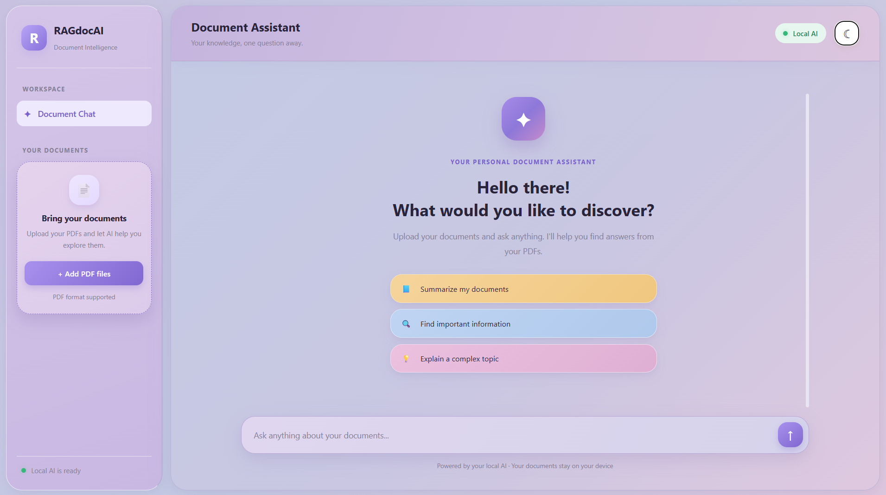
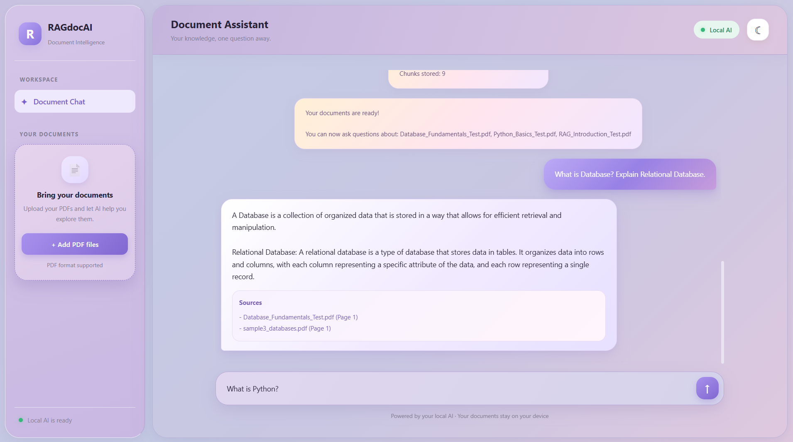
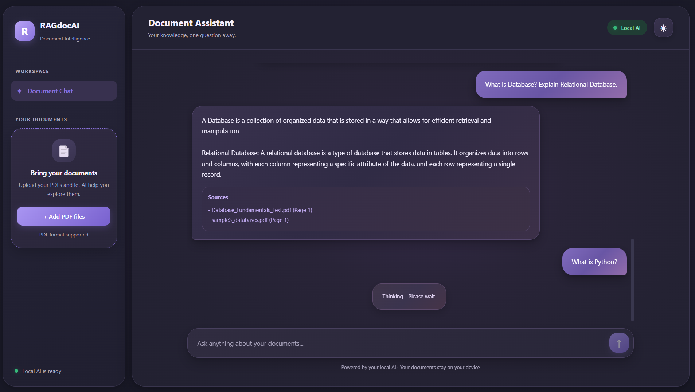

# RAGdocAI – User Interface Guide

This guide provides a visual overview of the RAGdocAI local web interface.

## 1. Home Screen

The home screen provides access to PDF uploads, the chat workspace, and the local AI status.

## 2. Ask Questions After Uploading a PDF

Upload your PDF document and ask questions in natural language. RAGdocAI retrieves relevant information from the uploaded documents and generates answers with source references.

## 3. Dark Mode

RAGdocAI also supports dark mode for a comfortable viewing experience. Your selected theme is remembered after refreshing the page.

---

**RAGdocAI** – Intelligent Document Retrieval & AI-Powered Answers.

Built with Python, FastAPI, HTML, CSS, JavaScript, Ollama and ChromaDB.